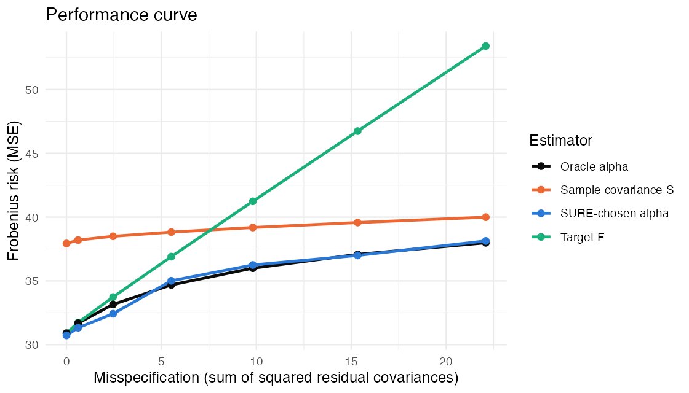
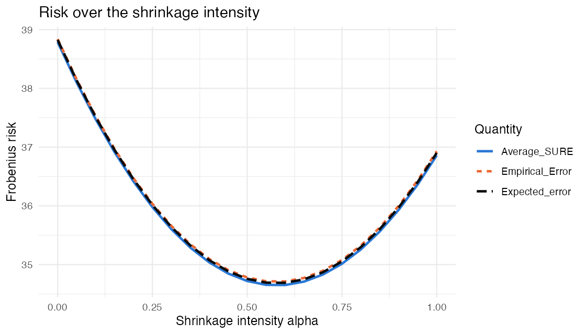

# SURE-tuned covariance shrinkage (senior thesis)

Choosing the Ledoit–Wolf shrinkage intensity α for Σ̂ = αF + (1−α)S by minimizing an
**exactly unbiased estimate of the risk (SURE)**, instead of an asymptotic formula, for
Sharpe's single-index target F.

## Performance curve

Frobenius risk (MSE) of four estimators as the true covariance moves away from the
single-index model (x-axis: sum of squared residual covariances, the analogue of the
magnitude of the mean in the James–Stein curve). The target F is best when the model is
right but degrades fast; the sample covariance S is flat but high. The SURE-chosen α
tracks the oracle α everywhere and beats both S and F once the model is even moderately
wrong. Simulated with N = 20 stocks, T = 40 days, jointly normal returns, 10,000 samples
per point.

## SURE matches the true risk

At one setting, the closed-form risk R(α), the empirical average loss, and the average
SURE coincide across α (20,000 samples), confirming that SURE is unbiased.

Code: [`sims/sure_single_index.qmd`](sims/sure_single_index.qmd) (R).
